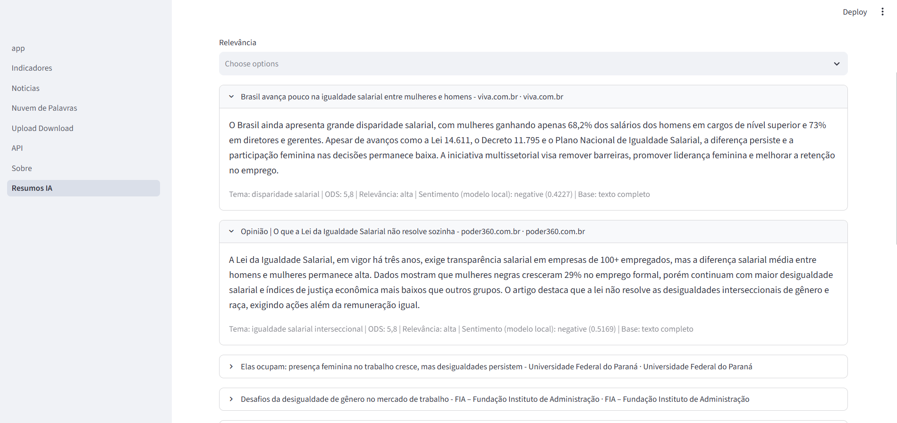
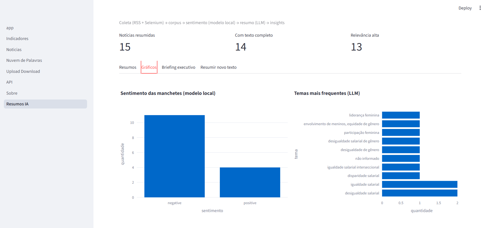
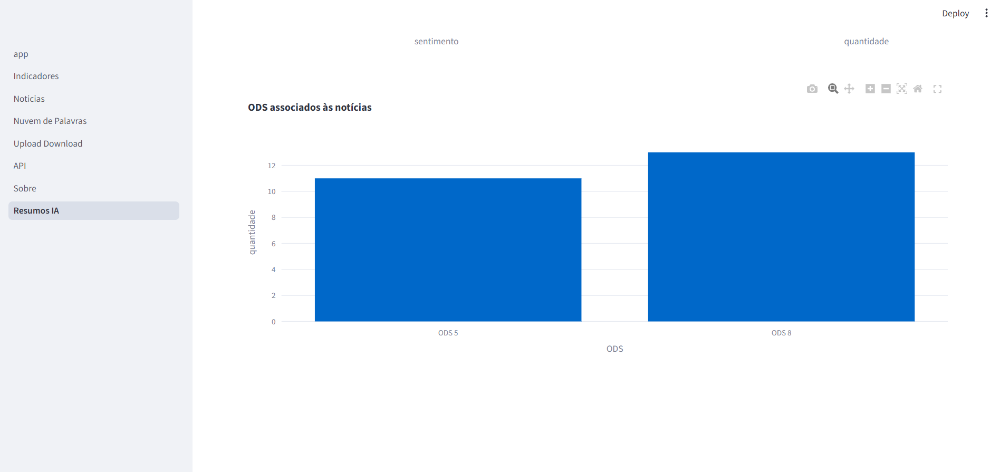
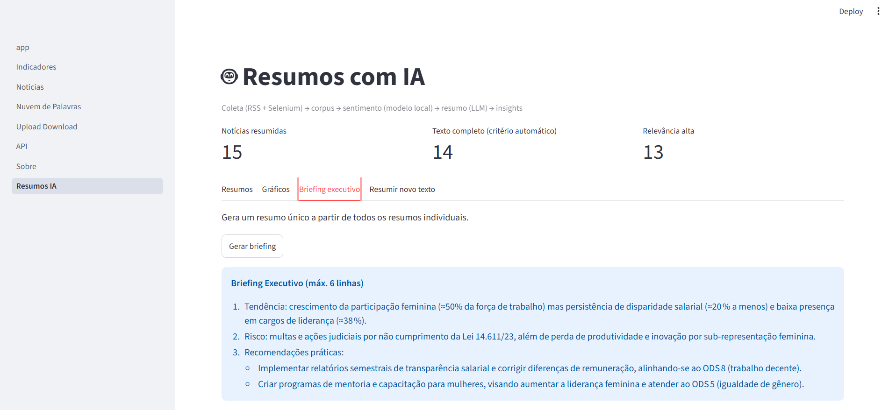
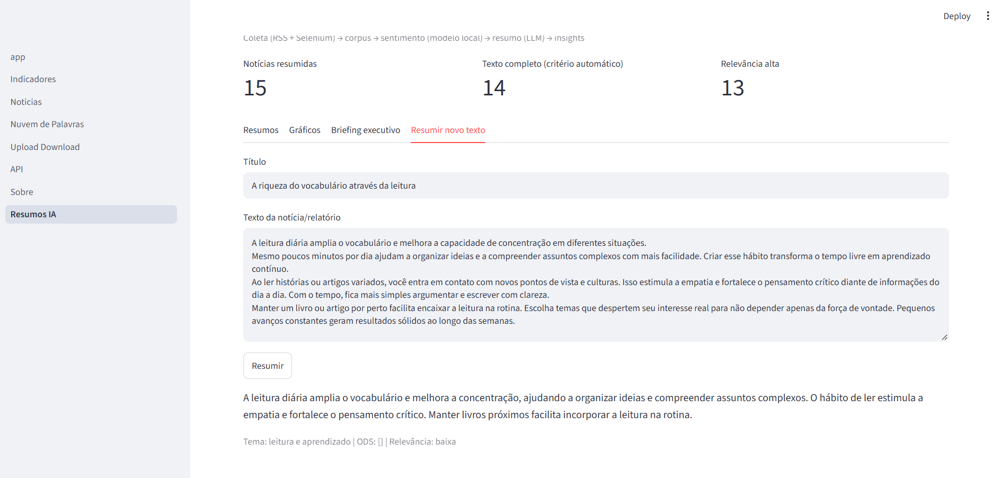

# Apresentação e Argumentação da Solução Final — EquidadeJá Brasil

**Projeto de Bloco:** Inteligência Artificial Aplicada
**Autora:** Giovanna Silva
**Etapa:** TP5, Tarefa 4 (apresentação e argumentação da solução final)

---

## 1. Resumo

O **EquidadeJá Brasil** é um painel sobre equidade de gênero no mercado de trabalho brasileiro. Na etapa final, o projeto passou a usar um modelo de linguagem (LLM) para **resumir automaticamente notícias** sobre o tema, classificando cada uma por tema, ODS, relevância e sentimento, e a exibir tudo em um dashboard interativo.

Em números: **15 notícias** de 15 fontes diferentes foram coletadas, preparadas, resumidas e avaliadas. Na conferência manual, **9 resumos saíram corretos, 4 parciais e nenhum errado** (nas 13 notícias com base para verificação). **13 notícias** se ligam ao ODS 8 e **11** ao ODS 5.

## 2. O problema de negócio e por que ele importa

A desigualdade de gênero no trabalho gera um fluxo contínuo de notícias, relatórios e dados oficiais. Esse material está em texto livre, vem de fontes diferentes e é grande demais para ser lido por inteiro por quem decide. Analistas de ESG, gestores de RH e de diversidade precisam saber **o que está sendo dito, com que dados e com que relevância**, sem ler centenas de páginas.

A pergunta do projeto é: **como transformar textos sobre equidade de gênero no trabalho em informação resumida, classificada e comparável, apoiando decisões de ESG e de diversidade?**

O tema se conecta diretamente a dois Objetivos de Desenvolvimento Sustentável da Agenda 2030:
- **ODS 5 (Igualdade de gênero):** participação feminina na liderança e igualdade de oportunidades.
- **ODS 8 (Trabalho decente e crescimento econômico):** igualdade de remuneração para trabalho de igual valor.

No ESG, o assunto toca o pilar **Social** (equidade e inclusão) e o de **Governança** (transparência salarial, exigida pela Lei 14.611/2023).

## 3. A solução em uma página

```
Coleta (RSS + Selenium) → Corpus → Sentimento (modelo local) → Resumo, tema, ODS e relevância (LLM) → Dashboard
```

| Etapa | O que foi feito | Por que importa |
|---|---|---|
| Coleta | Manchetes do Google News (RSS) e texto completo por Selenium | Sem o texto completo, o resumo seria apenas da manchete |
| Preparação | Corpus único com 15 notícias e 24 indicadores (transformados em frases) | O LLM interpreta frases melhor que tabelas |
| IA | Sentimento com modelo local; resumo, tema, ODS e relevância com LLM | Cada modelo faz o que faz melhor, com custo baixo |
| Avaliação | Cada resumo comparado com o texto original | Mostra onde a IA acerta e onde erra |
| Comunicação | Dashboard Streamlit com dados, gráficos e interação | Leva o resultado a quem decide, sem exigir código |

A seguir, cada etapa é justificada.

## 4. Os dados: reais, de fontes variadas e tratados

**Dados reais.** Todas as notícias vêm de veículos e instituições reais, como Poder360, O Globo, CartaCapital, CNN Brasil, FGV IBRE, FIEMG, Abramed e universidades federais. Os indicadores de gênero cobrem 2015 a 2022 (participação de mulheres e de homens na força de trabalho e assentos ocupados por mulheres no parlamento). As notícias foram publicadas entre 09/03/2022 e 18/09/2026.

**Por que dois métodos de coleta.** O RSS é rápido e dá título, fonte, data e link, mas não traz o texto. O Selenium abre cada página e extrai os parágrafos. Juntos, permitem resumir a matéria inteira.

**Preparação e qualidade.** O texto foi limpo (espaços repetidos removidos) e unificado com os indicadores em um único arquivo, o `corpus_llm.csv`. A verificação de qualidade revelou algo importante: das 15 notícias, **13 tinham texto útil**. Uma trazia só a manchete e outra trouxe o menu do site no lugar do artigo. Esse achado mostra por que a conferência dos dados vem antes da modelagem: sem ela, o resumo dessas duas notícias pareceria confiável sem ser.

## 5. IA e engenharia de prompts: como os modelos geram valor

**Dois modelos, duas funções.**

| Tarefa | Modelo | Onde roda | Justificativa |
|---|---|---|---|
| Sentimento das manchetes | `lxyuan/distilbert-base-multilingual-cased-sentiments-student` | Local | Rápido, gratuito e funciona sem internet |
| Resumo, tema, ODS, relevância e briefing | `openai/gpt-oss-20b` via API do Groq | Nuvem | Exige compreender o texto e devolver resposta estruturada |

**Engenharia de prompt.** O LLM recebe cada notícia dentro de um prompt construído com cinco técnicas:
1. **Papel:** analista de políticas públicas e ESG, especialista em equidade de gênero.
2. **Regras anti-alucinação:** usar somente o texto, escrever "não informado" quando faltar informação e nunca inventar números, nomes ou datas.
3. **Saída estruturada:** JSON com `resumo` (até 3 frases), `tema`, `ods` e `relevancia`, que alimenta direto o dashboard.
4. **Exemplo no prompt (few-shot):** mostra o formato esperado.
5. **Temperatura baixa (0,2):** respostas mais estáveis e menos criativas.

Esse desenho transforma texto livre em colunas de uma tabela, que é o que permite filtrar, contar e criar gráficos.

## 6. O dashboard: simples de usar, com profundidade nos resultados

A página **Resumos IA** tem quatro abas e não exige nenhum conhecimento técnico. O uso se resume a três ações: escolher a aba, filtrar por relevância se quiser e clicar em uma notícia ou em um botão.

### 6.1 Resumos
Lista todas as notícias com o resumo, o tema, os ODS, a relevância e o sentimento de cada uma.



### 6.2 Gráficos
Mostram o sentimento das manchetes (modelo local) e os temas mais frequentes (LLM).



Os ODS associados às notícias aparecem em um gráfico próprio:



### 6.3 Briefing executivo
Com um clique, o LLM resume todos os resumos em um texto curto, com tendências, riscos e recomendações práticas para empresas.



### 6.4 Resumir novo texto
O usuário cola qualquer texto e recebe o resumo em tempo real. Foi testado com um texto fora do tema (sobre leitura), e o sistema respondeu com **relevância baixa e nenhum ODS**, ou seja, não força uma ligação com a equidade de gênero onde ela não existe.



## 7. Insights gerados e relevância para governança e sustentabilidade

**O salário é o assunto central.** 8 das 15 notícias (53%) têm tema ligado à remuneração, seja igualdade, desigualdade ou disparidade salarial. O dado combina com a prioridade regulatória do período, a Lei da Igualdade Salarial.

**A agenda se divide entre os ODS 5 e 8.** 13 notícias citam o ODS 8 e 11 citam também o ODS 5. As duas notícias sem ODS são justamente aquelas sem base de texto útil.

**Os números citados nas notícias convergem.** Os relatórios mencionados nos textos apontam uma diferença salarial entre mulheres e homens na faixa de 20% a 25%: 21,3% no 5º Relatório de Transparência Salarial (Poder360), 20,9% no 3º relatório (Brasil de Fato) e 25,3% no rendimento médio do 1º trimestre de 2025 (FIEMG). Na liderança, a CartaCapital cita que apenas 17,4% das empresas brasileiras têm uma mulher na presidência. O painel reúne essas fontes em um só lugar, algo que exigiria a leitura de todos os textos.

**O briefing traduz os dados em ação.** Ele recomenda, por exemplo, manter a transparência salarial semestral e criar programas de mentoria para ampliar a liderança feminina, ligando cada ação ao ODS correspondente. Isso conecta a análise de dados a uma decisão de governança.

**O sentimento mostra o tom do debate.** 11 manchetes saíram negativas e 4 positivas, o que reflete uma pauta dominada pelas desigualdades que persistem.

## 8. Avaliação: quão confiáveis são os resultados

Cada resumo foi comparado com o texto original, incluindo conferência dos números, leis e nomes citados.

| Avaliação | Quantidade | Significado |
|---|---|---|
| Correto | 9 | Conteúdo e números conferem com o texto |
| Parcial | 4 | Correto na maior parte, com um detalhe mal interpretado |
| Errado | 0 | Nenhum resumo inventou informação |
| Sem base | 2 | Texto coletado inadequado, impossível de verificar |

**O que os erros ensinam.** Os 4 resumos parciais tiveram falhas de interpretação, não invenções: um dado de "subiu para 40,6%" virou "aumentou 40,6%"; uma diferença que aumentou na pandemia foi descrita como estagnada; o custo de cuidados infantis foi apresentado como causa única, quando o texto fala em "alguns dos motivos"; e ODS foram atribuídos a um texto que cita só a Agenda 2030. A conclusão prática é que o resumo automático acelera a leitura e ajuda a priorizar, mas **os números devem ser conferidos na fonte antes de uma decisão**. O detalhe de cada nota está em `avaliacao_resumos.csv`.

## 9. Limitações e próximos passos

**Limitações**
- Amostra pequena (15 notícias): os percentuais não devem ser generalizados.
- Cada notícia é enviada ao LLM com no máximo 4.000 caracteres, e há textos de até cerca de 15 mil.
- O sentimento mede o tom das palavras da manchete, não o impacto para a equidade. Por exemplo, uma manchete sobre o avanço de empresas com políticas de equidade saiu como negativa.
- A coleta falhou em uma notícia, e o campo que indica o texto completo não detectou o erro.

**Próximos passos**
- Ampliar a coleta para mais notícias e para relatórios de sustentabilidade de empresas.
- Validar o conteúdo coletado (e não só o tamanho) antes de resumir.
- Resumir textos longos em partes, sem truncar.
- Cruzar os resumos com os indicadores oficiais no mesmo painel.

## 10. Conclusão

O projeto demonstra o ciclo completo da Ciência de Dados: **coletou** dados reais por RSS e web scraping, **preparou** e verificou sua qualidade, **aplicou IA** com engenharia de prompts para transformar texto livre em informação estruturada, **avaliou** os resultados contra as fontes e **comunicou** tudo em um dashboard simples. A solução resolve o problema de negócio ao reduzir o esforço de acompanhar a pauta de equidade de gênero e ao ligar cada notícia aos ODS 5 e 8 e às práticas de ESG, sempre com a ressalva de que os resultados são sugestões e devem ser revisados por uma pessoa.

## 11. Uso de IA

- **Em tempo de execução:** modelo local de sentimento (HuggingFace) e modelo `openai/gpt-oss-20b` via API do Groq, para resumo, tema, ODS, relevância e briefing.
- **No desenvolvimento:** o Claude (Anthropic) foi usado como apoio ao código, à depuração, à avaliação preliminar dos resumos e à redação da documentação, com revisão da autora, que conferiu os resumos classificados como parciais contra os textos originais.
- Resultados de IA podem conter erros e viés, e por isso os resumos foram verificados contra as fontes.
