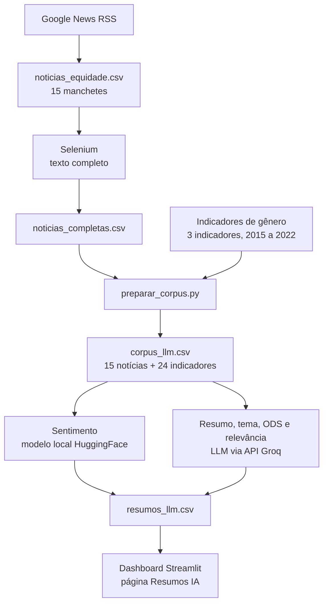

# Data Summary Report — EquidadeJá Brasil

**Projeto de Bloco:** Inteligência Artificial Aplicada
**Autora:** Giovanna Silva
**Etapa:** TP5 (versão final, com LLM e dashboard)
**Metodologia:** TDSP (Team Data Science Process)

---

## 1. Fontes de dados

| Fonte | Técnica | Arquivo gerado | Conteúdo |
|---|---|---|---|
| Feed RSS do Google News (busca: equidade de gênero e mercado de trabalho, pt-BR) | `requests` e Beautiful Soup (`coletor_noticias.py`) | `Data/Processed/noticias_equidade.csv` e `corpus_noticias.txt` | 15 manchetes: título, fonte, data e link |
| Páginas das matérias | Selenium com Chrome headless (`scraping_selenium.py`) | `Data/Processed/noticias_completas.csv` | URL final, texto e tamanho do texto |
| Indicadores de gênero e trabalho | Arquivo local (`Sample Data/amostra_indicadores_genero.csv`), identificado como "World Bank / amostra local" | Corpus em `Data/LLM/corpus_llm.csv` | 24 registros transformados em frases |
| LLM `openai/gpt-oss-20b` (Groq) | Chamada de API (`resumidor.py`) | `Data/LLM/resumos_llm.csv` | Resumo, tema, ODS e relevância |

**Período das notícias:** de 09/03/2022 a 18/09/2026 (data de publicação informada pelo feed).
**Período dos indicadores:** de 2015 a 2022.

Os 3 indicadores são:
- Taxa de participação na força de trabalho, mulheres (%)
- Taxa de participação na força de trabalho, homens (%)
- Assentos ocupados por mulheres no parlamento (%)

## 2. Fluxo dos dados

Em texto: Google News RSS → `noticias_equidade.csv` → Selenium (texto completo) → `noticias_completas.csv` → `preparar_corpus.py` → `corpus_llm.csv` → sentimento (modelo local) e resumo (LLM) → `resumos_llm.csv` → dashboard Streamlit.

## 3. Volume

| Item | Valor |
|---|---|
| `corpus_llm.csv` | 39 linhas (15 notícias e 24 indicadores) e 5 colunas |
| `resumos_llm.csv` | 15 linhas e 11 colunas |
| Fontes distintas de notícias | 15 |
| Tamanho dos textos das notícias | de 76 a 15.641 caracteres (mediana de cerca de 6.400) |

**Fontes das notícias:** viva.com.br, poder360.com.br, Universidade Federal do Paraná, FIA, ufop.br, Sapicuá, O Globo, Migalhas, Brasil de Fato, Blog do IBRE (FGV), Nova Escola, CartaCapital, FIEMG, Abramed e CNN Brasil.

## 4. Dicionário de dados

### 4.1 `Data/LLM/resumos_llm.csv`

| Coluna | Tipo | Descrição |
|---|---|---|
| `titulo` | texto | Manchete da notícia |
| `fonte` | texto | Veículo ou site de origem |
| `data` | texto | Data de publicação informada pelo feed |
| `base_resumo` | texto | "texto completo" ou "apenas manchete", conforme o tamanho do conteúdo coletado |
| `resumo` | texto | Resumo de até 3 frases gerado pelo LLM |
| `tema` | texto | Tema de 2 a 4 palavras atribuído pelo LLM |
| `ods` | texto | Números de ODS separados por vírgula (vazio quando não há) |
| `relevancia` | texto | alta, média ou baixa para a pauta de equidade de gênero no trabalho |
| `sentimento` | texto | `positive`, `neutral` ou `negative`, pelo modelo local |
| `confianca_sentimento` | número | Confiança do modelo, de 0 a 1 |
| `erro` | texto | Mensagem de erro da chamada ao LLM (vazio quando deu certo) |

### 4.2 `Data/LLM/corpus_llm.csv`

| Coluna | Tipo | Descrição |
|---|---|---|
| `tipo` | texto | "noticia" ou "indicador" |
| `titulo` | texto | Manchete (notícias) ou "Indicador" |
| `fonte` | texto | Veículo (notícias) ou "World Bank / amostra local" |
| `data` | texto ou número | Data de publicação (notícias) ou ano (indicadores) |
| `conteudo` | texto | Título e texto da matéria, ou o indicador escrito em uma frase |

## 5. Qualidade dos dados

| Aspecto | Resultado |
|---|---|
| Erros técnicos na geração dos resumos | 0 de 15 |
| Notícias com texto útil | 13 de 15 |
| Notícias só com a manchete | 1 (item 11), indicada corretamente em `base_resumo` |
| Notícias com texto coletado incorreto | 1 (item 5): o texto era o menu do site e não o artigo |
| `ods` vazio | 2 notícias |
| `tema` "não informado" | 1 notícia |

**Observação sobre o item 5.** O campo `base_resumo` marcou "texto completo" por engano, porque a regra considera apenas o tamanho do conteúdo (mais de 300 caracteres além do título) e não o seu conteúdo. O LLM respondeu corretamente que o texto não trazia informação sobre o tema, mas a relevância "baixa" e o tema "não informado" refletem a falha de coleta, não o assunto da matéria.

**Tratamento aplicado** (em `preparar_corpus.py`):
- Remoção de espaços repetidos nos textos.
- Junção de título e texto em um único campo.
- Conversão dos indicadores em frases, porque LLMs interpretam texto melhor que tabelas.

**Limitações:**
- Amostra pequena (15 notícias), que não permite generalizar os resultados.
- Truncamento em 4.000 caracteres por notícia no envio ao LLM, que afeta os textos mais longos.
- Os indicadores vêm de uma amostra local, e não de uma consulta direta à API do Banco Mundial.

## 6. Integração dos dados

Os dados de RSS (manchetes), de Selenium (texto completo) e dos indicadores foram unificados em um único corpus (`corpus_llm.csv`). Sobre ele, o modelo local acrescentou o sentimento e o LLM acrescentou resumo, tema, ODS e relevância, gerando o `resumos_llm.csv`. É esse arquivo que alimenta os gráficos e as tabelas do dashboard, sem depender de novas chamadas à API.

## 7. Resultados da análise

| Resultado | Valor |
|---|---|
| Notícias associadas ao ODS 8 | 13 de 15 |
| Notícias associadas ao ODS 5 | 11 de 15 |
| Tema mais frequente | Remuneração (igualdade, desigualdade ou disparidade salarial): 8 de 15 |
| Relevância atribuída pelo LLM | 13 alta, 1 média, 1 baixa |
| Sentimento das manchetes | 11 negativo, 4 positivo, 0 neutro |
| Sentimentos com confiança abaixo de 0,50 | 5 de 15 |
| Qualidade dos resumos (13 avaliáveis) | 9 corretos, 4 parciais, 0 errados |

O detalhe da avaliação de cada resumo está em `avaliacao_resumos.csv`.

## 8. Ferramentas

Python, pandas, requests, Beautiful Soup, Selenium, Transformers (HuggingFace), Streamlit, Plotly e API do Groq (`openai/gpt-oss-20b`).

## 9. Uso de IA

O sentimento é calculado por um modelo local da HuggingFace. O resumo, o tema, os ODS, a relevância e o briefing são gerados pelo modelo `openai/gpt-oss-20b` via API do Groq. O Claude (Anthropic) foi usado como apoio ao código, à avaliação preliminar dos resumos e à redação desta documentação, com revisão da autora. Resultados de IA podem conter erros e viés, e por isso os resumos foram conferidos contra os textos originais.
